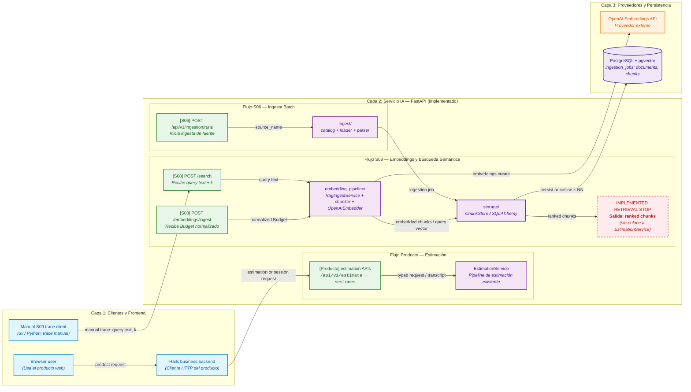

# Diagnóstico arquitectónico — Sesión 09 (pre-work)

> Las observaciones están en español; los comandos, payloads y nombres de campo se conservan en inglés. La evidencia de ejecución se capturó el 31 de octubre de 2026 contra el servicio local.

---

## 1. Diagrama de la arquitectura actual

El sistema conserva tres capas, pero tiene dos caminos que conviene no confundir. El flujo de producto de Rails usa las rutas de estimación ya existentes; el trace de esta práctica es un cliente manual que llama directamente a la rama S08 `POST /search`. Los presupuestos históricos de S08 se dividen estructuralmente, se embeben y se guardan como `documents`/`chunks` en PostgreSQL con pgvector. Esa rama de recuperación termina en **ranked chunks** y no está conectada al pipeline de estimación ya existente.



**Cómo leerla.** El diagrama se organiza en tres capas de izquierda a derecha para que el flujo de datos sea claro y sin cruces de flechas sobre los nodos: a la **izquierda**, la capa cliente/frontend (`Browser user`, `Rails business backend` y el cliente manual `Manual S09 trace client`); en el **centro**, el `Servicio IA — FastAPI` con sus flujos internos delimitados (Producto, Ingesta S06 y RAG S08); a la **derecha**, la persistencia y proveedores externos (`OpenAI Embeddings API` y `PostgreSQL + pgvector`). El camino de producto fluye `Browser → Rails → estimation APIs → EstimationService`. La ingesta S06 fluye `POST /api/v1/ingestion/runs → ingest/ → storage/`. El trace manual S09 llama directamente a `POST /search → embedding_pipeline/ → storage/`, conectando con OpenAI para vectorizar y con Postgres para la similitud coseno. Se marca explícitamente el punto de parada en `IMPLEMENTED RETRIEVAL STOP`: los *ranked chunks* salen de `storage/` pero no tienen conexión con `EstimationService`. Rails usa estimación/sesiones (`estimator-web/app/services/estimator_ai/estimations_client.rb:6-10`, `sessions_client.rb:26-44`); S06 registra trabajos (`estimator/app/api/ingestion.py:71-131`); S08 persiste y busca (`estimator/app/generation/rag/ingest_service.py:57-85`, `retriever.py:37-61`).

**Inventario actual, fuera del trace manual.** `POST /api/v1/ingestion/runs` valida una fuente, crea un *job* y lanza la orquestación S06; `GET /api/v1/ingestion/jobs/{job_id}` consulta su estado (`estimator/app/api/ingestion.py:71-131`). Esto no es una entrada de `RagIngestService`. En cambio, `POST /embeddings/ingest` recibe un `Budget` ya normalizado y hace el camino S08 `chunk → embed → persist` (`estimator/app/api/embeddings.py:33-78`, `estimator/app/generation/rag/ingest_service.py:57-85`). `POST /embeddings/compare` compara estrategias y no persiste nada (`estimator/app/api/embeddings.py:81-124`).

---

## 2. Trace anotado de `02_ambiguous.txt`

**Precondición observada.** El servicio respondió HTTP `200` y el comando terminó con estado `0`:

```bash
curl -sS -i --max-time 15 http://127.0.0.1:8000/health
```

```text
HTTP/1.1 200 OK

{"status":"healthy","version":"0.1.0","environment":"development"}
```

### Paso 1 — Embeber la transcripción completa

No hay un endpoint HTTP que exponga un vector crudo: `POST /search` lo crea internamente. Por eso se usa el cliente mínimo existente `examples/trace_s09.py`, que lee el archivo completo y llama a `embeddings.create` con el mismo `EMBEDDING_MODEL` configurado para el servicio. El secreto se carga desde el entorno y nunca se imprime.

```bash
set -a; . estimator/.env; set +a
ESTIMATOR_BASE_URL=http://127.0.0.1:8000 \
  uv run examples/trace_s09.py examples/02_ambiguous.txt
```

La llamada terminó con estado `0`. La salida cruda relevante del paso de embedding fue:

```text
STEP 1 — embedding of the full transcript
transcript      : examples/02_ambiguous.txt
model           : text-embedding-3-small
dimensionality  : 1536
L2 norm         : 1.000350
first component : 0.006248
last component  : 0.019028
```

El vector representa toda la conversación, no una sola funcionalidad: mezcla venta online, fidelización, panel, stock, pago y confirmación por email, además de incertidumbre de alcance. Por ello es útil para recuperar afinidad semántica general, pero no decide qué señales son obligatorias ni cuáles son hipótesis. Este vector es una llamada independiente del cliente de trace: en el paso 2 `/search` recibe el texto de nuevo y ejecuta otra llamada de embedding interna; no recibe ni reutiliza el vector mostrado aquí.

### Paso 2 — Búsqueda semántica (top-5)

La reproducción se hizo con la transcripción leída directamente desde el archivo, `k: 5`, HTTP `200` y estado de salida `0`:

```bash
jq -n --rawfile query examples/02_ambiguous.txt \
  '{query: $query, k: 5}' > /tmp/s09-search-request.json
curl -sS -o /tmp/s09-search-replay.json -w '%{http_code}\n' \
  -X POST http://127.0.0.1:8000/search \
  -H 'Content-Type: application/json' \
  --data @/tmp/s09-search-request.json
```

La respuesta siguiente es el cuerpo JSON sin modificar de esa repetición (`/tmp/s09-search-replay.json`):

```json
{"query":"Reunión exploratoria — sin título claro todavía\nCliente: Rubén Castaño (gerente, Casa Castaño — tienda de productos gourmet)\nConsultor: equipo de estimación\nFecha: primera toma de contacto\n\n[00:00:08] Consultor: Buenas, Rubén. Cuéntame, ¿qué os ronda por la cabeza?\n\n[00:00:15] Rubén: Pues mira, es que llevamos dándole vueltas un tiempo y no sé muy bien por dónde\nempezar, por eso os hemos llamado. Tenemos la tienda física de toda la vida, la de mi padre, llevamos\ncon ella desde el noventa y dos. Conservas, vinos, aceite, esas cosas. Y claro, vemos que el mundo va\npor otro lado y que hay que dar el salto, pero no tenemos ni idea de tecnología, ¿eh?, te lo digo ya.\n\n[00:01:02] Consultor: Sin problema, para eso estamos. ¿Qué te gustaría conseguir?\n\n[00:01:09] Rubén: A ver, lo ideal sería vender por internet, eso seguro. Que la gente entre, vea los\nproductos y compre, ¿no? Pero también... mira, mi sobrina, que de esto sabe más que yo, me dice que\nlo importante hoy es fidelizar. Que un cliente que repite vale más que diez que vienen una vez. Y yo\npienso, pues igual algo de puntos, o un club, no sé, que la gente acumule y luego canjee. Eso me\ngustaría. Aunque tampoco quiero liarlo mucho al principio, ¿eh?\n\n[00:02:05] Consultor: Vale. ¿Y cómo te imaginas el día a día gestionándolo?\n\n[00:02:12] Rubén: Pues eso es lo otro. Yo necesito ver qué se vende. Un panel, algo donde yo entre\npor la mañana con el café y vea los pedidos del día, lo que más se mueve, el stock... que ahora lo\nllevo en un cuaderno, te lo juro. Mi mujer me dice que parezco del siglo pasado. Algo visual, con sus\ngráficas, para tomar decisiones. Eso lo veo clarísimo, lo del panel de control.\n\n[00:03:01] Rubén: Ah, y oye, una cosa importante: que la gente pueda pagar con tarjeta, claro. Eso es\nfundamental, que el pago sea fácil y seguro, que no se me vayan en el último paso. He oído que mucha\ngente llena el carrito y luego no paga, y eso no puede ser.\n\n[00:03:40] Consultor: Totalmente. ¿Tenéis volumen previsto, mercados, algo de eso?\n\n[00:03:47] Rubén: Uf, pues no sabría decirte. España de momento, supongo. Aunque un primo en Francia\nme dice que allí los productos españoles se venden solos, así que quién sabe, igual más adelante.\nPero no me hagas mucho caso con eso. Y mira, también pensaba... no sé si es mucho pedir, pero estaría\nbien mandar un correo cuando alguien compra, para que sepa que va su pedido. Detalles, ¿sabes? Que el\ncliente se sienta atendido como en la tienda de siempre.\n\n[00:04:35] Rubén: En fin, que tampoco quiero marearos. Que sé que esto es un mundo. Lo que necesito\nes que me digáis vosotros, que sois los que sabéis, qué se puede hacer y más o menos cuánto cuesta.\nYo de presupuestos de software ni idea, ¿eh? Decidme un número y vemos.\n\n[00:05:02] Consultor: Tranquilo, Rubén, lo recogemos y te volvemos con una propuesta. Gracias.\n","k":5,"search_time_ms":700,"results":[{"chunk_id":16,"document_id":5,"chunk_type":"budget_component","content":"[Project: Headless e-commerce storefront with personalized recommendations]\n[Client sector: ecommerce | Year: 2024 | Main tech: node]\n\nComponent: Product catalog API\nDescription: GraphQL catalog API with faceted search, inventory availability and multi-currency pricing backed by Elasticsearch.\nTech stack: node, graphql, elasticsearch\nComplexity: medium\nEstimated hours: 150","distance":0.6082639021301803,"metadata":{"year":2024,"budget_id":"BUD-2024-005","complexity":"medium","component_id":"CATALOG-001","client_sector":"ecommerce","estimated_hours":150,"main_technology":"node"}},{"chunk_id":17,"document_id":5,"chunk_type":"budget_component","content":"[Project: Headless e-commerce storefront with personalized recommendations]\n[Client sector: ecommerce | Year: 2024 | Main tech: node]\n\nComponent: Cart and checkout service\nDescription: Stateless cart service with promotion engine, tax calculation and a checkout orchestration that integrates the payment provider.\nTech stack: node, redis, postgresql\nComplexity: high\nEstimated hours: 140","distance":0.6137697724280501,"metadata":{"year":2024,"budget_id":"BUD-2024-005","complexity":"high","component_id":"CART-002","client_sector":"ecommerce","estimated_hours":140,"main_technology":"node"}},{"chunk_id":18,"document_id":5,"chunk_type":"budget_component","content":"[Project: Headless e-commerce storefront with personalized recommendations]\n[Client sector: ecommerce | Year: 2024 | Main tech: node]\n\nComponent: Personalized recommendations\nDescription: Collaborative-filtering recommendations served from a feature store and exposed as a low-latency API for product and cart pages.\nTech stack: node, redis\nComplexity: medium\nEstimated hours: 110","distance":0.6372103049960407,"metadata":{"year":2024,"budget_id":"BUD-2024-005","complexity":"medium","component_id":"RECO-003","client_sector":"ecommerce","estimated_hours":110,"main_technology":"node"}},{"chunk_id":19,"document_id":5,"chunk_type":"budget_component","content":"[Project: Headless e-commerce storefront with personalized recommendations]\n[Client sector: ecommerce | Year: 2024 | Main tech: node]\n\nComponent: Storefront PWA\nDescription: Progressive web app storefront consuming the headless APIs with server-side rendering for SEO.\nTech stack: next_js, react\nComplexity: low\nEstimated hours: 60","distance":0.6387895243952637,"metadata":{"year":2024,"budget_id":"BUD-2024-005","complexity":"low","component_id":"STORE-004","client_sector":"ecommerce","estimated_hours":60,"main_technology":"node"}},{"chunk_id":27,"document_id":8,"chunk_type":"budget_component","content":"[Project: Fashion returns management and resale portal]\n[Client sector: ecommerce | Year: 2023 | Main tech: dotnet]\n\nComponent: Returns portal\nDescription: Self-service returns portal with label generation, reason capture and automatic restock or resale routing.\nTech stack: dotnet, sqlserver\nComplexity: medium\nEstimated hours: 140","distance":0.6443960372171129,"metadata":{"year":2023,"budget_id":"BUD-2024-008","complexity":"medium","component_id":"RET-001","client_sector":"ecommerce","estimated_hours":140,"main_technology":"dotnet"}}]}
```

### Paso 3 — Lectura de los chunks devueltos

1. **`chunk_id: 16` — `BUD-2024-005`, sector `ecommerce`.** El catálogo e inventario encajan con la venta online y la necesidad de controlar stock. Es relevante por sector y capacidad, aunque GraphQL, Elasticsearch y multimoneda no aparecen confirmados en la transcripción.
2. **`chunk_id: 17` — `BUD-2024-005`, sector `ecommerce`.** Carrito, checkout e integración de pago se alinean directamente con el requisito explícito de pago con tarjeta. Es el resultado funcionalmente más cercano, pero el trace no transforma esa coincidencia en un alcance o estimación.
3. **`chunk_id: 18` — `BUD-2024-005`, sector `ecommerce`.** Las recomendaciones personalizadas pueden relacionarse de forma amplia con fidelización, pero el cliente habló de puntos o club, no de *collaborative filtering*. La relevancia es parcial y el resultado introduce una solución que no fue decidida.
4. **`chunk_id: 19` — `BUD-2024-005`, sector `ecommerce`.** Una tienda web permite vender online, por lo que es relevante a alto nivel. PWA, React y SSR para SEO no están solicitados ni priorizados en la conversación.
5. **`chunk_id: 27` — `BUD-2024-008`, sector `ecommerce`.** Comparte sector, pero el portal de devoluciones no aparece en el alcance conversado. Es una coincidencia sectorial con relevancia baja para esta estimación.

---

## 3. Diagnóstico: cinco fallos identificados

### 1. Un único vector mezcla señales de alcance incompatibles

**Problema observado.** El vector del Paso 1 representa toda la conversación (venta online, puntos o club, panel con stock, tarjeta y email), pero los cinco vecinos no separan esas señales: aparece `Personalized recommendations` (`chunk_id: 18`) aunque el cliente pidió puntos o club, y no aparece un componente que nombre el panel, las gráficas o el email de confirmación. La transcripción sí los declara explícitamente (`examples/02_ambiguous.txt:15-19,23-30,34-38`).

**Causa probable.** `POST /search` recibe un único `query` de texto y `SemanticRetriever` lo embebe completo antes de pedir los `k` vecinos por distancia coseno (`estimator/app/generation/rag/retriever.py:37-61`); no hay una representación que marque alcance confirmado, opcional, descartado o incierto.

**Propuesta de solución.** Incorporar conceptualmente un **NEW Scope structurer** que reciba la transcripción cruda y produzca un *structured brief* con necesidades, prioridades, restricciones e incertidumbres para los pasos posteriores.

### 2. La distancia semántica no decide relevancia funcional

**Problema observado.** El resultado de devolución (`chunk_id: 27`, distancia `0.644396`) comparte el sector `ecommerce`, pero no responde a ningún requisito expresado; y las recomendaciones personalizadas (`chunk_id: 18`, `0.637210`) solo se parecen de forma amplia a fidelización. El trace demuestra que estar entre los cinco vecinos no equivale a ser evidencia aceptable para Casa Castaño.

**Causa probable.** `ChunkStore.search` ordena exclusivamente por distancia coseno y limita a `k` (`estimator/app/generation/rag/store/repository.py:62-86`); la respuesta devuelve contenido, distancia y metadatos, pero ninguna decisión de pertinencia respecto del alcance (`estimator/app/generation/rag/schemas.py:114-132`).

**Propuesta de solución.** Añadir conceptualmente un **NEW Evidence adjudicator** que reciba el *structured brief* y los *retrieved evidence*, y emita evidencia aceptada o descartada con una justificación trazable.

### 3. No se comprueba cobertura de los requisitos explícitos

**Problema observado.** Los cinco hits cubren catálogo/inventario, checkout, recomendaciones, storefront y devoluciones; ninguno cubre de forma directa el panel de pedidos y gráficas, el programa de puntos/club ni el correo de confirmación que aparecen en la transcripción. El trace no informa qué requisitos quedaron sin respaldo.

**Causa probable.** El contrato actual de búsqueda expone una lista plana de `SearchHit`; no conserva una matriz entre señales del cliente y chunks recuperados (`estimator/app/generation/rag/schemas.py:107-132`). Por ello la búsqueda no puede distinguir cobertura completa de una coincidencia parcial de sector.

**Propuesta de solución.** Incorporar conceptualmente un **NEW Scope coverage map** que compare el *structured brief* con los candidatos recuperados y produzca *covered signals*, *gaps* y preguntas pendientes, sin alterar el retriever actual.

### 4. Los chunks recuperados no se convierten en insumos de estimación

**Problema observado.** El trace devuelve horas aisladas (`150`, `140`, `110`, `60` y `140`) dentro de cinco chunks, pero no selecciona cuáles pertenecen al alcance, no consolida un conjunto y no produce una estimación. La respuesta de `/search` termina en `results` y `search_time_ms`, no en un objeto de estimación.

**Causa probable.** `SemanticRetriever.search` construye y devuelve solamente `SearchResponse` (`estimator/app/generation/rag/retriever.py:46-70`); el contrato de resultado contiene `SearchHit`, no un artefacto de composición de presupuesto (`estimator/app/generation/rag/schemas.py:114-132`).

**Propuesta de solución.** Añadir conceptualmente un **NEW Estimation evidence composer** que convierta la evidencia aceptada, las brechas y los supuestos en *estimation inputs* y un *estimation draft* revisable.

### 5. La rama S08 termina antes del pipeline de estimación existente

**Problema observado.** El diagrama y el trace muestran que la rama S08 concluye en *ranked chunks*. Aunque FastAPI ya dispone de `EstimationService`, la búsqueda no lo invoca ni entrega su resultado a ese servicio: `/search` delega en `SemanticRetriever` (`estimator/app/api/search.py:22-42`) y la estimación usa `service.estimate(...)` por una ruta distinta (`estimator/app/api/estimations.py:28-43`).

**Causa probable.** Son dos flujos independientes: la recuperación re-embebe el `query` y devuelve hits, mientras `EstimationService` genera una respuesta estructurada desde su propia solicitud (`estimator/app/domain/estimation_service.py:128-191`). El vector mostrado en el Paso 1 es además una llamada diagnóstica independiente; `/search` vuelve a embeber el texto y no recibe ese vector (`retriever.py:37-44`).

**Propuesta de solución.** Incorporar conceptualmente un **NEW Retrieval-to-estimation bridge** que entregue los *estimation inputs* validados al pipeline de estimación existente y conserve el enlace entre la estimación y su evidencia.

---

## 4. Propuesta de evolución arquitectónica

La siguiente figura es **objetivo conceptual**, no una descripción de componentes desplegados ni una propuesta de nuevos endpoints.

```mermaid
flowchart LR
    %% Definición de estilos
    classDef client fill:#e1f5fe,stroke:#0288d1,stroke-width:2px,color:#01579b
    classDef existing fill:#f3e5f5,stroke:#7b1fa2,stroke-width:2px,color:#4a148c
    classDef existingApi fill:#e8f5e9,stroke:#388e3c,stroke-width:2px,color:#1b5e20
    classDef newComp fill:#e0f2f1,stroke:#00796b,stroke-width:2px,stroke-dasharray: 4 4,color:#004d40
    classDef external fill:#fff3e0,stroke:#f57c00,stroke-width:2px,color:#e65100
    classDef db fill:#ede7f6,stroke:#512da8,stroke-width:2px,color:#311b92

    %% Capa 1: Frontend y Clientes (Izquierda)
    subgraph layer_clients ["Capa 1: Clientes y Frontend"]
        direction TB
        browser_target["Browser user<br/><i>(Entrega transcripción y recibe estimación)</i>"]:::client
        rails_target["Rails business backend<br/><i>(Cliente HTTP del producto)</i>"]:::client

        browser_target -->|raw transcript| rails_target
    end

    %% Capa 2: Servicio IA — FastAPI (Centro)
    subgraph ai_target ["Capa 2: Servicio IA — FastAPI (objetivo conceptual)"]
        direction TB

        subgraph input_stage ["1. Entrada y Estructuración (NUEVO)"]
            scope_structurer["NEW Scope structurer<br/><i>Extrae alcance, prioridades, restricciones e incertidumbres</i>"]:::newComp
        end

        subgraph retrieval_stage ["2. Búsqueda y Recuperación S08 (EXISTENTE)"]
            direction TB
            search_existing["EXISTING POST /search<br/><code>Recibe retrieval query + k</code>"]:::existingApi
            embedding_existing["EXISTING embedding_pipeline/<br/><i>OpenAIEmbedder (query text → vector)</i>"]:::existing
            storage_existing["EXISTING storage/<br/><i>ChunkStore (cosine k-NN)</i>"]:::existing

            search_existing -->|query text| embedding_existing
            embedding_existing -->|query vector| storage_existing
        end

        subgraph adjudication_stage ["3. Cobertura y Adjudicación de Evidencia (NUEVO)"]
            direction TB
            coverage_map["NEW Scope coverage map<br/><i>Detecta cobertura y brechas frente al brief</i>"]:::newComp
            evidence_adjudicator["NEW Evidence adjudicator<br/><i>Acepta o descarta evidencia con motivo</i>"]:::newComp
            evidence_composer["NEW Estimation evidence composer<br/><i>Arma inputs y borrador trazable</i>"]:::newComp

            coverage_map -->|coverage, gaps, required signals| evidence_adjudicator
            evidence_adjudicator -->|accepted evidence + rationale| evidence_composer
        end

        subgraph closing_stage ["4. Enlace y Estimación Final"]
            direction TB
            retrieval_bridge["NEW Retrieval-to-estimation bridge<br/><i>Entrega inputs validados al pipeline</i>"]:::newComp
            estimation_existing["EXISTING EstimationService<br/><i>Genera estimación estructurada</i>"]:::existing
            retrieval_bridge -->|validated estimation inputs| estimation_existing
        end

        %% Conexiones internas de la Capa 2
        scope_structurer -->|retrieval query| search_existing
        scope_structurer -->|structured brief| coverage_map
        storage_existing -->|retrieved evidence| coverage_map
        evidence_composer -->|estimation inputs / draft| retrieval_bridge
    end

    %% Capa 3: Persistencia y Proveedores Externos (Derecha)
    subgraph layer_external ["Capa 3: Proveedores y Persistencia (EXISTENTE)"]
        direction TB
        openai_embeddings_target["OpenAI Embeddings API<br/><i>Proveedor externo existente</i>"]:::external
        shared_db_target[("PostgreSQL + pgvector<br/><i>documents; chunks</i>")]:::db
    end

    %% Conexiones inter-capas
    rails_target -->|raw transcript| scope_structurer
    embedding_existing -->|embeddings.create| openai_embeddings_target
    storage_existing -->|cosine k-NN| shared_db_target

    %% Retorno de la estimación cerrada hacia el usuario
    estimation_existing -->|generated estimation| rails_target
    rails_target -.->|generated estimation| browser_target
```



El **NEW Scope structurer** transforma la conversación en un *structured brief*; el **NEW Scope coverage map** muestra qué señales tienen evidencia y cuáles faltan.<br>
El **NEW Evidence adjudicator** evita tratar todo vecino semántico como requisito; el **NEW Estimation evidence composer** convierte evidencia aceptada y supuestos en un borrador trazable.<br>
El **NEW Retrieval-to-estimation bridge** entrega esos *estimation inputs* a `EstimationService`, que retorna la estimación generada al producto.<br>
La prioridad inicial es **NEW Scope structurer**, porque el trace actual mezcla en un único vector requisitos confirmados, opcionales e inciertos antes de recuperar evidencia.
